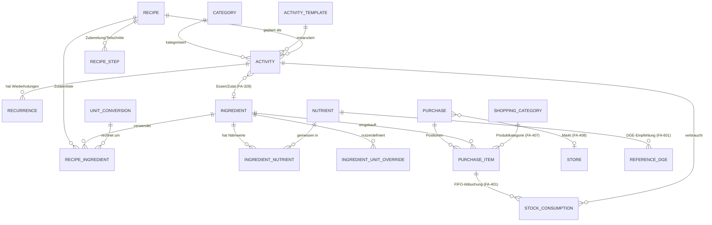

# Datenbank-Design: LifeCompanion

**Version:** 0.1 · **Status:** verbindliche Ausgestaltung des Datenmodells aus Lastenheft Abschnitt 6 (FA-850) · **Reifegrad:** umsetzungsreife Skizze für M1, Anpassungen wären versioniert zu ändern

## 1. Grundlagen

**Konventionen**

- Ziel-DB: **SQLite** (expo-sqlite über das DbDriver-Port, WAL-Modus; kein ORM – Lastenheft Anhang C, T-1); `FOREIGN KEY`-Prüfung aktiviert (`PRAGMA foreign_keys = ON`).
- Jede Datenbank-Datei trägt ihre Versionsstände selbst (`db_meta`: `schema_version`, `seed_version`, `app_version_erstellt`).
- Kalender-/Zeitwerte als ISO-8601-Text (`YYYY-MM-DD`, `YYYY-MM-DDTHH:MM`) – Sortierung und Zeitraum-Vergleiche (`BETWEEN`, `ORDER BY`) sind in SQLite lexikographisch korrekt.

**Datenbank-Dateien (FA-851)**

| Datei | Inhalt | Bemerkung |
|---|---|---|
| `app.db` | Profil-Registry, globale Einstellungen (u. a. **Sprache**, FA-106), **Provider-Einwilligungen (FA-507)** | einzige App-globale DB |
| `profiles/<uuid>.db` | **alle** Profil-Daten: Aktivitäten, Rezepte, Zutaten, Bestand, Statistik-Basis, Katalog-/Seed-Tabellen | **ein Profil = eine Datei**; Profilwechsel = Datei-Wechsel |

Da Katalog-/Seed-Tabellen (FA-852) beim Anlegen **in jede Profildatenbank** eingespielt werden, sind zur Laufzeit genau **zwei Verbindungen** offen: `app.db` + aktives Profil-DB. Die gebrauchte DB-Library muss mehrere Verbindungen verwalten (FA-851); Katalog-Tabellen sind auch Profil-übergreifend separat editierbar (nutzergetrieben, per Profil).

**Generation/-Versionen: `db_meta`** in jeder DB: `schema_version` (Migration-Level, FA-850), `seed_version`, `app_version_erstellt`.

## 2. ER-Modell (Überblick)



**Zentrale Ableitungsregeln**

- **kcal wird nie gespeichert** (O-2/FA-329) – View `v_ingredient_kcal_100` (Abschnitt 5) bzw. EnergyCalculator rechnen zur Laufzeit.
- **Serienlogik** (FA-207/213) liegt im Profile-DB; Systemkalender erhält nur expandierte Instanzen.
- **Bestand** ist ein **abgeleiteter Zustand**: `purchase_item.menge` − Σ `stock_consumption.menge` (FIFO, FA-401); nichts anderes wird geschrieben.

## 3. Schema: `app.db` (Profil-Registry, global)

```sql
CREATE TABLE db_meta (
  schluessel TEXT PRIMARY KEY,          -- 'schema_version', 'seed_version', 'app_version_erstellt'
  wert       TEXT NOT NULL
);

CREATE TABLE profile_registry (
  id           TEXT PRIMARY KEY,        -- UUID
  name         TEXT NOT NULL,
  db_datei     TEXT NOT NULL UNIQUE,    -- 'profiles/<uuid>.db'
  erstellt_am  TEXT NOT NULL
);

CREATE TABLE app_settings (
  schluessel TEXT PRIMARY KEY,          -- z. B. 'sprache' (FA-106), 'letztes_aktiv_profil'
  wert       TEXT NOT NULL
);

CREATE TABLE provider_consent (         -- FA-507, O-8
  provider      TEXT PRIMARY KEY,       -- 'openfoodfacts' | 'usda' | 'naehrwertrechner' | 'fddb' | 'rewe'
  akzeptiert_am TEXT                   -- NULL = nie kontaktieren
);
```

## 4. Schema: `profiles/<uuid>.db` (Profil-Inhalt + Katalog)

### 4.1 Profil und Organisation

```sql
CREATE TABLE db_meta (
  schluessel TEXT PRIMARY KEY,
  wert       TEXT NOT NULL
);

CREATE TABLE profile (                             -- FA-101
  id                TEXT PRIMARY KEY,
  name              TEXT NOT NULL,
  geburtsdatum      TEXT NOT NULL,                 -- ISO-Datum
  geschlecht        TEXT NOT NULL CHECK (geschlecht IN ('maennlich','weiblich','divers')),
  gewicht_kg        REAL NOT NULL,
  groesse_cm        REAL,
  aktivitaetslevel  TEXT NOT NULL DEFAULT 'moderat',
  waehrung           TEXT NOT NULL DEFAULT 'EUR'    -- FA-106
);

CREATE TABLE settings (                            -- pro Profil (FA-613, FA-214)
  schluessel TEXT PRIMARY KEY,                     -- 'prognose_fenster_tage' (Standard 14), 'kalender_filter_kategorien', 'rezeptbuch_default_range'
  wert       TEXT NOT NULL
);

CREATE TABLE category (                            -- FA-901, Seed FA-852
  id         INTEGER PRIMARY KEY,
  name       TEXT NOT NULL UNIQUE,
  farbe      TEXT NOT NULL,                        -- Hex
  icon       TEXT,
  sortierung INTEGER NOT NULL DEFAULT 0
);
```

### 4.2 Kalender und Aktivitäten

```sql
CREATE TABLE activity (                            -- FA-206, FA-210, FA-328
  id            TEXT PRIMARY KEY,
  titel         TEXT NOT NULL,
  beschreibung  TEXT,
  typ           TEXT NOT NULL DEFAULT 'normal'
                CHECK (typ IN ('normal','essen_rezept','essen_zutat')),
  kategorie_id  INTEGER NOT NULL REFERENCES category(id),
  prioritaet    TEXT NOT NULL DEFAULT 'verfuegbar'
                CHECK (prioritaet IN ('beschaeftigt','abwesend','verfuegbar')),
  start         TEXT NOT NULL,                     -- 'YYYY-MM-DDTHH:MM'
  ende          TEXT NOT NULL,
  vorlage_id    INTEGER REFERENCES activity_template(id),
  rezept_id     TEXT     REFERENCES recipe(id),    -- bei typ='essen_rezept'
  portionen     REAL NOT NULL DEFAULT 1 CHECK (portionen > 0),
  ingredient_id INTEGER REFERENCES ingredient(id), -- bei typ='essen_zutat' (FA-328)
  zutat_menge   REAL,
  zutat_einheit TEXT CHECK (zutat_einheit IS NULL OR zutat_einheit IN ('g','ml')),
  systemkalender_event_id TEXT                    -- Sync-Ziel FA-200/201
);
CREATE INDEX idx_activity_start   ON activity(start, ende);
CREATE INDEX idx_activity_kategorie ON activity(kategorie_id);

CREATE TABLE activity_template (                   -- FA-208
  id              INTEGER PRIMARY KEY,
  titel           TEXT NOT NULL,
  beschreibung    TEXT,
  kategorie_id    INTEGER NOT NULL REFERENCES category(id),
  dauer_min       INTEGER NOT NULL,
  kcal_pro_stunde REAL                             -- NULL/0 = verbraucht nichts (FA-208)
);

CREATE TABLE recurrence (                          -- FA-207a–d, mehrere pro Aktivität
  id            INTEGER PRIMARY KEY,
  aktivitaet_id TEXT NOT NULL REFERENCES activity(id) ON DELETE CASCADE,
  typ           TEXT NOT NULL
                CHECK (typ IN ('intervall','monatstag','jahrstag','wochentage')),
  intervall     INTEGER NOT NULL DEFAULT 1,        -- x Stunden/Tage/Wochen/Monate/Jahre
  einheit       TEXT CHECK (einheit IN ('stunden','tage','wochen','monate','jahre')),
  wochentage    TEXT,                              -- JSON-Array [0..6], 0=Mo (FA-207d; kombiniert mit 'wochen' = FA-207a)
  tag_im_monat  INTEGER CHECK (tag_im_monat BETWEEN 1 AND 31),
  tag_im_jahr   TEXT,                              -- 'MM-TT' inkl. Schaltjahrregel (FA-207c)
  startdatum    TEXT NOT NULL,
  enddatum      TEXT                               -- NULL = offen (FA-207)
);
CREATE INDEX idx_recurrence_activity ON recurrence(aktivitaet_id);
```

CREATE TABLE calendar_sync (                       -- FA-200/201/213 (Rev. 16, Migration 0002)
  aktivitaet_id       TEXT    NOT NULL,          -- weiche Referenz auf activity(id): kein FK,
                                                      -- damit das Loeschen der Aktivitaet die
                                                      -- Mapping-Zeilen nicht mitnimmt (der Sync
                                                      -- entfernt so auch die Geraete-Events)
  ordinal             INTEGER NOT NULL,          -- Ordinal innerhalb der sortierten Instanzen
  external_id         TEXT    NOT NULL UNIQUE,   -- Geraete-Event-ID des Systemkalenders
  instanz_start       TEXT    NOT NULL,          -- 'YYYY-MM-DDTHH:MM' (Wanduhr)
  titel               TEXT    NOT NULL,
  ende                TEXT    NOT NULL,
  zuletzt_geschrieben TEXT    NOT NULL           -- Wanduhr des letzten App-Pushs (LWW pro Instanz)
);
CREATE INDEX idx_calendar_sync_external ON calendar_sync(external_id);
CREATE INDEX idx_calendar_sync_instanz  ON calendar_sync(instanz_start);
```

### 4.3 Zutaten, Nährstoffe, Rezepte

```sql
CREATE TABLE ingredient (                          -- FA-320
  id              TEXT PRIMARY KEY,
  name            TEXT NOT NULL,
  basis_einheit   TEXT NOT NULL CHECK (basis_einheit IN ('g','ml')),
  stueckgewicht_g REAL,                            -- z. B. 1 Karotte ≈ 80 g (FA-331)
  dichte_g_pro_ml REAL,
  barcode         TEXT                             -- FA-410
);
CREATE UNIQUE INDEX idx_ingredient_barcode ON ingredient(barcode) WHERE barcode IS NOT NULL;

CREATE TABLE nutrient (                            -- FA-322, FA-323, FA-340; Seed FA-852
  id                INTEGER PRIMARY KEY,
  name              TEXT NOT NULL UNIQUE,          -- 'Eiweiß', 'Vitamin B12', 'Wasser', …
  kategorie         TEXT NOT NULL
                    CHECK (kategorie IN ('basis','vitamin','mineral','spurenelement','lipid','aminosaeure','alkohol','sonstiges')),
  einheit           TEXT NOT NULL CHECK (einheit IN ('mg','µg','ml')),
  stufe             TEXT NOT NULL
                    CHECK (stufe IN ('pflicht','empfohlen','optional')),  -- FA-340
  normfaktor_nach_µg REAL NOT NULL                -- mg→1000, µg→1, ml(Wasser)→1 (FA-322)
);

CREATE TABLE ingredient_nutrient (                 -- FA-321/322; Herkunft FA-506
  ingredient_id        TEXT NOT NULL REFERENCES ingredient(id) ON DELETE CASCADE,
  nutrient_id          INTEGER NOT NULL REFERENCES nutrient(id),
  wert_normiert_pro_100 REAL NOT NULL CHECK (wert_normiert_pro_100 >= 0),
  quelle               TEXT,                       -- 'openfoodfacts' | 'naehrwertrechner' | … | 'manuell'
  abgefragt_am         TEXT,
  PRIMARY KEY (ingredient_id, nutrient_id)
);

CREATE TABLE recipe (                              -- FA-301, FA-302, FA-307
  id                        TEXT PRIMARY KEY,
  titel                     TEXT NOT NULL,
  typ                       TEXT NOT NULL DEFAULT 'hauptgericht'
                            CHECK (typ IN ('hauptgericht','beilage','getraenk','snack','sonstiges')),
  kalorien_soll_pro_portion REAL                  -- reiner Anzeige-/Referenzwert (FA-302)
);

CREATE TABLE recipe_step (                         -- FA-300/302: Zubereitung incl. Teilschritte
  id          INTEGER PRIMARY KEY,
  recipe_id   TEXT NOT NULL REFERENCES recipe(id) ON DELETE CASCADE,
  laufnummer  INTEGER NOT NULL,                    -- 1, 2, 3 … (sequenziell, FA-300)
  titel       TEXT NOT NULL,                       -- z. B. 'Teig herrrichten'
  beschreibung TEXT,
  dauer_min   INTEGER NOT NULL DEFAULT 0,
  UNIQUE (recipe_id, laufnummer)
);

CREATE TABLE recipe_ingredient (                   -- FA-330/333
  recipe_id    TEXT NOT NULL REFERENCES recipe(id) ON DELETE CASCADE,
  zeilen_nr    INTEGER NOT NULL,
  ingredient_id TEXT NOT NULL REFERENCES ingredient(id),
  menge        REAL NOT NULL CHECK (menge > 0),
  einheit      TEXT NOT NULL CHECK (einheit IN
               ('g','kg','ml','l','TL','EL','prise','tasse_150','tasse_250','tasse_330','stueck')),
  PRIMARY KEY (recipe_id, zeilen_nr)
);

CREATE TABLE unit_conversion (                     -- FA-331; Seed FA-852
  einheit               TEXT PRIMARY KEY,          -- 'TL','EL','prise','tasse_150','tasse_250','tasse_330'
  faktor_ml             REAL NOT NULL,             -- 1 TL = 5 ml
  default_g_faktor_ml   REAL                       -- Default-Dichte, wenn keine Override existiert
);

CREATE TABLE ingredient_unit_override (            -- FA-331: nutzerdefiniert
  ingredient_id TEXT NOT NULL REFERENCES ingredient(id) ON DELETE CASCADE,
  einheit       TEXT NOT NULL REFERENCES unit_conversion(einheit),
  gramm         REAL NOT NULL,
  PRIMARY KEY (ingredient_id, einheit)
);
```

### 4.4 Einkauf, Bestand, Referenzen

```sql
CREATE TABLE shopping_category (                   -- FA-407; Seed FA-852
  id    INTEGER PRIMARY KEY,
  name  TEXT NOT NULL UNIQUE                       -- Milchprodukte, Obst, Gemüse, Snacks, …
);

CREATE TABLE store (                               -- FA-407/408
  id   INTEGER PRIMARY KEY,
  name TEXT NOT NULL UNIQUE
);

CREATE TABLE purchase (
  id      TEXT PRIMARY KEY,
  datum   TEXT NOT NULL,
  markt_id INTEGER REFERENCES store(id),           -- NULL = unbekannt (FA-407)
  notiz   TEXT
);
CREATE INDEX idx_purchase_datum ON purchase(datum);

CREATE TABLE purchase_item (                       -- FA-400/403/404/407
  id                  TEXT PRIMARY KEY,
  purchase_id         TEXT NOT NULL REFERENCES purchase(id) ON DELETE CASCADE,
  ingredient_id       TEXT NOT NULL REFERENCES ingredient(id),
  menge               REAL NOT NULL CHECK (menge > 0),
  einheit             TEXT NOT NULL CHECK (einheit IN ('g','kg','ml','l')),
  zustand             TEXT,                        -- 'TK' | 'trocken' | 'frisch' | … (FA-403)
  shopping_category_id INTEGER REFERENCES shopping_category(id),
  preis               REAL CHECK (preis IS NULL OR preis >= 0),   -- FA-407; Währung = profile.waehrung
  mhd                 TEXT,                        -- ISO-Datum (FA-404)
  uebrig_gelassen     REAL                         -- Reste-Anteil, Ausbaustufe (FA-610)
);
CREATE INDEX idx_purchase_item_ingredient ON purchase_item(ingredient_id);
CREATE INDEX idx_purchase_item_mhd        ON purchase_item(mhd) WHERE mhd IS NOT NULL;

CREATE TABLE stock_consumption (                   -- FA-401 FIFO-Abbuchung
  id               INTEGER PRIMARY KEY,
  purchase_item_id TEXT NOT NULL REFERENCES purchase_item(id),
  aktivitaet_id    TEXT REFERENCES activity(id),   -- wer hat abgebucht
  datum            TEXT NOT NULL,
  menge            REAL NOT NULL CHECK (menge > 0),
  einheit          TEXT NOT NULL CHECK (einheit IN ('g','ml'))
);
CREATE INDEX idx_consumption_posten ON stock_consumption(purchase_item_id);

CREATE TABLE reference_dge (                       -- FA-601; Seed FA-852
  nutrient_id   INTEGER NOT NULL REFERENCES nutrient(id),
  altersgruppe  TEXT NOT NULL,                     -- K-Default-Gruppen: 15-19/19-25/25-51/51-65/65+;
                                                   -- aktuell geseedet: nur '25-51' (FA-852, Prüfung M3)
  geschlecht    TEXT NOT NULL CHECK (geschlecht IN ('maennlich','weiblich','divers')),
  empfohlen_tag REAL NOT NULL,                     -- je Tag, in nutrient.einheit
  PRIMARY KEY (nutrient_id, altersgruppe, geschlecht)
);
```

## 5. Berechnungs-View (kcal, FA-329/O-2)

```sql
-- kcal je 100 g/ml Zutat aus den Makros (O-2/FA-329); Werte intern µg-normiert (FA-322)
CREATE VIEW v_ingredient_kcal_100 AS
SELECT i.id AS ingredient_id,
       ROUND( ( COALESCE(MAX(CASE WHEN n.name = 'Eiweiß'        THEN inr.wert_normiert_pro_100 END), 0) * 4
              + COALESCE(MAX(CASE WHEN n.name = 'Kohlenhydrate' THEN inr.wert_normiert_pro_100 END), 0) * 4
              + COALESCE(MAX(CASE WHEN n.name = 'Fett'          THEN inr.wert_normiert_pro_100 END), 0) * 9
              + COALESCE(MAX(CASE WHEN n.name = 'Ballaststoffe' THEN inr.wert_normiert_pro_100 END), 0) * 2
              + COALESCE(MAX(CASE WHEN n.name = 'Alkohol'       THEN inr.wert_normiert_pro_100 END), 0) * 7
              ) / 1000000.0, 1) AS kcal_pro_100
FROM ingredient i
LEFT JOIN ingredient_nutrient inr ON inr.ingredient_id = i.id
LEFT JOIN nutrient n              ON n.id = inr.nutrient_id
GROUP BY i.id;
```

Hinweis: `wert_normiert_pro_100` liegt intern **µg-normiert** je 100 g/ml (FA-322), daher die Division durch 1.000.000 (µg → g) vor den Atwater-Faktoren. Der EnergyCalculator (UseCase) rechnet dieselbe Regel in TypeScript für Rezept-Skalierung; der View dient DB-seitiger Prüfung und Export (`kalorien_soll_pro_portion` bleibt reiner Anzeigewert, FA-302).

## 6. Seed-Daten (FA-852/853)

Beim Anlegen jeder Profildatenbank werden eingespielt (Version in `db_meta.seed_version`):

| Tabelle | Seed-Inhalt |
|---|---|
| `category` | Standard-Kategorien: Sport, Arbeit, Studium, Kochen/Rezepte, Hygiene, Haushalt, Sonstiges (FA-852) |
| `nutrient` | Nährstoff-Katalog: 6 Pflichtkern (Protein, Fett, Kohlenhydrate, Zucker, Ballaststoffe, Wasser), 13 Vitamine, 13 Mineralstoffe/Spurenelemente, Lipide (gesättigt/einfach/mehrfach), Aminosäuren-Grundset, Alkohol – je mit `einheit` und `stufe` (FA-322/340) |
| `unit_conversion` | TL (5 ml), EL (15 ml), Prise (0,5 ml), Tasse 150/250/330 ml; Default-Dichten für häufige Mittel (FA-331) |
| `shopping_category` | Milchprodukte, Obst, Gemüse, Kartoffeln, Getreide/Backwaren, Fleisch/Fisch, Tiefkühl, Snacks, Getränke, Sonstiges (FA-407) |
| `reference_dge` | DGE-Referenzwerte je Nährstoff × Altersgruppe × Geschlecht; `empfohlen_tag` in der **Anzeigeeinheit** des Nährstoffs pro Tag, intern µg via `normfaktor_nach_µg` (Lastenheft Anhang C, T-6); kann leer bleiben → „Referenzwert fehlt“ (FA-800) |
| `app.db: provider_consent` | alle Provider mit `akzeptiert_am = NULL` – **kein Provider wird ohne Einwilligung kontaktiert** (FA-507, O-8) |
| optional | einige Beispiel-Zutaten/Rezepte (kann leer bleiben, FA-853) |

Fehlen Seed-Daten (Beschädigung), werden die Tabellen **leer angelegt** (FA-853) – alle Constraint-Definitionen erlauben leere Tabellen; die App degradiert auf manuelle Erfassung (FA-800).

## 7. Migrationen und Pflege (FA-850)

- Ein nummeriertes Migrationsverzeichnis `migrations/` (`0001_init.sql`, `0002_….sql`); jede Migration läuft in einer Transaktion und aktualisiert `db_meta.schema_version`. Schemaumbrüche werden nicht an alten Dateien vollzogen.
- Anpassungen nach M1: neue Migration, **kein** Umbau alter Dateien. Das Export-Bundle (FA-104) enthält die Ziel-Versionen aus `db_meta`; der Import prüft die Kompatibilität.
- Löschen eines Profils = Löschen der Profildatei (FA-851); `app.db`-Eintrag wird mitgelöscht.

## 8. Test-Fixtures (FA-854/855)

- Seed-Daten dienen als wiederverwendbare Fixtures; zusätzlich ein **synthetischer Datensatz** (Profile „Test“ mit deterministischen Rezepten/Makros) für reproduzierbare Statistik-Ergebnisse.
- DB-Integrationstests laufen gegen **jedes** Migrationslevel (0001 → aktuell) und prüfen insbesondere: FIFO-Abbuchung (FA-401), µg-Normierung (FA-322), kcal-View vs. EnergyCalculator (FA-329), DGE-Aggregation (FA-610/613).
